<div align="center">


   

**[▶ Live Preview](https://maidajaved23.github.io/Python-Conditions-and-Loops/)** · [Local preview](preview.html) · [Task 1](#task-1-student-scholarship-eligibility-system) · [Task 2](#task-2-smart-pharmacy-inventory--sales-management-system) · [ER Diagram](#data-model-er-diagram) · [How to Run](#how-to-run-the-programs)

</div>

## Contents

- [Repository Name](#repository-name)
- [Project Overview](#project-overview)
- [Live Preview](#live-preview)
- [Required Project Structure](#required-project-structure)
- [Requirements](#requirements)
- [Task 1: Student Scholarship Eligibility System](#task-1-student-scholarship-eligibility-system)
  - [Purpose](#purpose)
  - [Scholarship Rules](#scholarship-rules)
  - [How the Program Works](#how-the-program-works)
  - [Eligibility Decision Logic](#eligibility-decision-logic)
  - [Input Validation](#input-validation)
  - [Python Concepts Used](#python-concepts-used)
  - [Sample Execution: Eligible Student](#sample-execution-eligible-student)
  - [Sample Execution: Ineligible Student](#sample-execution-ineligible-student)
- [Task 2: Smart Pharmacy Inventory & Sales Management System](#task-2-smart-pharmacy-inventory--sales-management-system)
  - [Purpose](#purpose-1)
  - [How the Program Works](#how-the-program-works-1)
  - [Processing Flow](#processing-flow)
  - [Important Calculations](#important-calculations)
  - [Counters and Accumulators](#counters-and-accumulators)
  - [Input Validation](#input-validation-1)
  - [Python Concepts Used](#python-concepts-used-1)
  - [Sample Execution](#sample-execution)
  - [Sample Run Analytics](#sample-run-analytics)
- [Additional Test Scenarios](#additional-test-scenarios)
  - [Task 1 scenarios](#task-1)
  - [Task 2 scenarios](#task-2)
- [Data Model (ER Diagram)](#data-model-er-diagram)
  - [Combined ER Overview](#combined-er-overview)
  - [Scholarship Data Model](#scholarship-data-model)
  - [Pharmacy Data Model](#pharmacy-data-model)
- [Python Concepts at a Glance](#python-concepts-at-a-glance)
- [How to Run the Programs](#how-to-run-the-programs)
  - [Option 1: Run with a Terminal or Command Prompt](#option-1-run-with-a-terminal-or-command-prompt)
  - [Option 2: Run with VS Code](#option-2-run-with-vs-code)
  - [GitHub Upload and Submission](#github-upload-and-submission)
  - [Suggested Git Commit Message](#suggested-git-commit-message)
  - [Suggested Repository Description](#suggested-repository-description)
  - [Console UI/UX Notes](#console-uiux-notes)
  - [Scope Notes](#scope-notes)
  - [Final Submission Checklist](#final-submission-checklist)
- [Credits and Links](#credits-and-links)

A beginner-friendly Python console project containing two separate applications. The first uses conditional statements to evaluate student scholarship eligibility. The second uses a `for` loop to process pharmacy inventory and calculate sales revenue.

## Repository Name

`python-conditions-loops-assessment`

## Project Overview

This assessment demonstrates how Python can solve two everyday business problems:

1. **Student Scholarship Eligibility System:** checks a student's marks, attendance, and monthly family income against the scholarship rules.
2. **Smart Pharmacy Inventory & Sales Management System:** processes medicine stock and sales, calculates revenue, and identifies medicines that need restocking.

Both programs are separate, menu-free console applications. Run the file for the task you want to demonstrate.

## Live Preview

▶ **[Open the live preview website](https://maidajaved23.github.io/Python-Conditions-and-Loops/)** (hosted from `preview.html` with GitHub Pages), or open the local file **[`preview.html`](preview.html)** shows the animated header and footer, both flowcharts, the threshold gauges, test-scenario matrix, sample-run charts, all three ER diagrams, and the concepts chart on one page.

> GitHub displays `.html` files as source code, so use the live link above: <https://maidajaved23.github.io/Python-Conditions-and-Loops/>. To see the page rendered offline, open `preview.html` in any browser.

## Required Project Structure

```text
python-conditions-loops-assessment/
├── student_scholarship_system.py
├── pharmacy_inventory_system.py
└── README.md
```

Optional presentation files (not required for submission): `preview.html` and the `assets/` folder with the animated SVGs.

```text
assets/
├── header.svg                 footer.svg
├── btn-author.svg             btn-github.svg            btn-star.svg
├── scholarship-flow.svg       scholarship-thresholds.svg
├── pharmacy-flow.svg          pharmacy-insights.svg     sample-analytics.svg
├── scenario-matrix.svg        python-concepts.svg
└── er-diagram.svg             er-scholarship.svg        er-pharmacy.svg
```

## Requirements

- Python 3.8 or newer.
- A terminal, command prompt, or Python IDE such as VS Code or IDLE.
- No third-party libraries are required. Both programs use Python's built-in features.

---

# Task 1: Student Scholarship Eligibility System

## Purpose

The program collects a student's name, academic marks, attendance percentage, and monthly family income. It validates the entries, checks all three eligibility conditions, decides the scholarship category, and prints a complete evaluation report.

## Scholarship Rules

| Requirement | Condition |
|---|---:|
| Academic marks | At least 80% |
| Attendance | At least 85% |
| Monthly family income | Rs. 50,000 or less |
| Full Scholarship | Eligible student with marks of 90% or above |
| Partial Scholarship | Eligible student with marks from 80% to below 90% |

A student must satisfy **all three eligibility requirements** to receive a scholarship. If one or more requirements are not met, the report lists every reason for ineligibility.

<p align="center"></p>

## How the Program Works

1. Displays the program title.
2. Asks for the student's name.
3. Checks that the name is not blank.
4. Asks for academic marks and validates that the value is numeric and between 0 and 100.
5. Asks for attendance and applies the same percentage validation.
6. Asks for monthly family income and checks that it is a valid, non-negative number.
7. Checks marks, attendance, and income separately using `if` statements.
8. Adds each failed requirement to a `reasons` list, so the student can see all reasons rather than only the first one.
9. If there are no failed requirements, uses `if` and `elif` to select Full or Partial Scholarship.
10. Prints the student's details, eligibility status, scholarship result, and any reason for ineligibility.

## Eligibility Decision Logic

<p align="center"></p>

- If marks are below 80%, the academic requirement is not met.
- If attendance is below 85%, the attendance requirement is not met.
- If monthly family income is above Rs. 50,000, the income requirement is not met.
- If all requirements are met and marks are at least 90%, the result is **Full Scholarship**.
- If all requirements are met and marks are from 80% to below 90%, the result is **Partial Scholarship**.

The program checks each requirement independently. This means it can display more than one ineligibility reason when applicable.

## Input Validation

- Student name cannot be empty.
- Marks must be numeric and between 0 and 100, inclusive.
- Attendance must be numeric and between 0 and 100, inclusive.
- Monthly family income must be numeric and cannot be negative.
- `try/except` catches invalid numeric input and asks the user to enter it again.

## Python Concepts Used

- `input()` to collect user information.
- `print()` to display prompts and the final report.
- Variables with meaningful names.
- `float()` for marks, attendance, and income.
- `while` loops to repeat prompts until valid input is entered.
- `try/except` and `ValueError` for input validation.
- `if`, `elif`, and `else` for decision-making.
- Comparison operators: `<`, `>=`, and `>`.
- A list and `append()` to collect all ineligibility reasons.
- `len()` to check whether any reasons were recorded.
- `enumerate()` to number the reasons.
- f-strings and numeric formatting such as `:.2f` and `:,.2f`.
- A `main()` function and the `if __name__ == "__main__":` entry point.

## Sample Execution: Eligible Student

```text
================================================
       STUDENT SCHOLARSHIP ELIGIBILITY
================================================
Enter student name: Ayesha Khan
Enter academic marks (0-100%): 92
Enter attendance percentage (0-100%): 90
Enter monthly family income (Rs.): 45000

================================================
           SCHOLARSHIP EVALUATION REPORT
================================================
Student Name       : Ayesha Khan
Academic Marks     : 92.00%
Attendance         : 90.00%
Monthly Family Income: Rs. 45,000.00
------------------------------------------------
Eligibility Status : ELIGIBLE
Scholarship Result : Full Scholarship

Congratulations! All scholarship requirements are satisfied.
================================================
```

## Sample Execution: Ineligible Student

```text
Enter student name: Ali
Enter academic marks (0-100%): 75
Enter attendance percentage (0-100%): 80
Enter monthly family income (Rs.): 60000

Eligibility Status : NOT ELIGIBLE
Scholarship Result : Not Eligible

Reason(s) for ineligibility:
1. Academic marks are below the required 80%.
2. Attendance is below the required 85%.
3. Monthly family income is above Rs. 50,000.
```

---

# Task 2: Smart Pharmacy Inventory & Sales Management System

## Purpose

The program asks how many different medicines the pharmacy wants to process. It then collects each medicine's name, available stock, unit price, and requested sales quantity. It checks stock availability, calculates successful sales, updates remaining stock, warns about low stock, and calculates total pharmacy revenue.

## How the Program Works

1. Displays the pharmacy program title.
2. Asks how many different medicines will be processed.
3. Validates that the medicine count is a whole number greater than zero.
4. Initializes the revenue accumulator, restocking counter, and processed-medicine counter.
5. Uses `for` with `range()` to repeat the medicine-entry process the required number of times.
6. For each medicine, asks for its name, available stock, price per unit, and quantity to sell.
7. Validates the medicine name, stock, price, and quantity.
8. Checks whether the requested quantity is greater than available stock.
9. If stock is insufficient, the sale is not completed, revenue for that medicine remains zero, and the available stock remains unchanged.
10. If stock is sufficient, calculates `quantity sold × price per unit`, subtracts the sold quantity from stock, and adds the sales amount to total revenue.
11. Checks whether remaining stock is below 10 units. If it is, displays a low-stock warning and increases the restocking counter.
12. Stores each medicine's result and prints a final report after the loop finishes.

## Processing Flow

<p align="center"></p>

## Important Calculations

**Sales amount**

```python
sales_amount = quantity_sold * price_per_unit
```

**Remaining stock after a successful sale**

```python
remaining_stock = available_stock - quantity_sold
```

**Total pharmacy revenue**

```python
total_revenue += sales_amount
```

The `+=` operator is an accumulator update. It adds each successful medicine sale to the running revenue total.

## Counters and Accumulators

| Variable | Purpose |
|---|---|
| `processed_count` | Counts how many medicine entries have been processed. |
| `restock_count` | Counts medicines whose remaining stock is below 10 units. |
| `total_revenue` | Accumulates the sales amount from successful sales. |

A medicine is counted for restocking when its remaining stock is below 10 units. This check is made after the stock outcome is determined, including when a requested sale could not be completed.

## Input Validation

- Medicine count must be a whole number greater than zero.
- Medicine name cannot be empty.
- Available stock must be a whole number and cannot be negative.
- Price per unit must be a valid number greater than zero.
- Quantity to sell must be a whole number and cannot be negative.
- Invalid numeric input is caught with `try/except`, and the program asks again.

## Python Concepts Used

- `input()` and `print()`.
- Variables and meaningful variable names.
- `int()` and `float()` for numeric conversion.
- `while` loops for input validation.
- `for` loop for processing multiple medicines.
- `range(1, medicine_count + 1)` to repeat the required number of times.
- `if` and `else` for stock availability decisions.
- Conditions inside a loop for low-stock checks.
- Arithmetic operators: `*` and `-`.
- `+=` for accumulator and counter updates.
- Lists and dictionaries to store medicine reports.
- `append()` to save each medicine's result.
- `enumerate()` to number the final report entries.
- `try/except` and `ValueError` for input validation.
- f-strings and currency formatting.
- A `main()` function and the `if __name__ == "__main__":` entry point.

## Sample Execution

```text
====================================================
       SMART PHARMACY INVENTORY & SALES
====================================================
How many different medicines do you want to process? 2

--- Medicine 1 of 2 ---
Enter medicine name: Panadol
Enter available stock: 30
Enter price per unit (Rs.): 25
Enter quantity to sell: 8
Sale amount: Rs. 200.00
Remaining stock: 22 unit(s)

--- Medicine 2 of 2 ---
Enter medicine name: Vitamin C
Enter available stock: 12
Enter price per unit (Rs.): 50
Enter quantity to sell: 5
Sale amount: Rs. 250.00
Remaining stock: 7 unit(s)
LOW-STOCK WARNING: This medicine needs restocking.

====================================================
             DAILY PHARMACY REPORT
====================================================

1. Panadol
   Sale status       : Successful
   Quantity sold     : 8
   Sales amount      : Rs. 200.00
   Remaining stock   : 22
   Requires restock  : No

2. Vitamin C
   Sale status       : Successful
   Quantity sold     : 5
   Sales amount      : Rs. 250.00
   Remaining stock   : 7
   Requires restock  : Yes

----------------------------------------------------
Total medicines processed : 2
Total pharmacy revenue    : Rs. 450.00
Medicines needing restock : 1
====================================================
```

## Sample Run Analytics

<p align="center"></p>

<p align="center"></p>

# Additional Test Scenarios

Test the programs with more than one kind of input before submitting:

### Task 1

<p align="center"></p>

1. Marks 95, attendance 90, income Rs. 40,000: eligible for Full Scholarship.
2. Marks 85, attendance 86, income Rs. 50,000: eligible for Partial Scholarship.
3. Marks 79, attendance 90, income Rs. 40,000: ineligible because of marks.
4. Marks 90, attendance 84, income Rs. 40,000: ineligible because of attendance.
5. Marks 90, attendance 90, income Rs. 50,001: ineligible because of income.
6. Enter text instead of a number for marks or income: the program should show an error and ask again.
7. Enter a percentage below 0 or above 100: the program should reject it.

### Task 2

1. Sell fewer units than the available stock: sale succeeds and stock decreases.
2. Sell exactly all available units: sale succeeds and remaining stock becomes zero.
3. Request more units than available: sale is rejected and revenue does not increase.
4. Leave fewer than 10 units after a sale: low-stock warning appears.
5. Enter zero stock or zero quantity: the program handles the values without a negative stock balance.
6. Enter text where a number is required: the program shows an error and asks again.
7. Process multiple medicines: the final revenue and restocking count should include all entries correctly.

---

# Data Model (ER Diagram)

The programs do not use a database. These diagrams are conceptual models of the information each program creates, so the relationships between inputs, results, and totals are easy to see.

## Combined ER Overview

<p align="center"></p>

## Scholarship Data Model

<p align="center"></p>

## Pharmacy Data Model

<p align="center"></p>

---

# Python Concepts at a Glance

Both tasks share a common core of ten concepts. Task 1 adds three decision-focused concepts, and Task 2 adds five loop and accumulator concepts.

<p align="center"></p>

---

# How to Run the Programs

## Option 1: Run with a Terminal or Command Prompt

1. Install Python 3.
2. Download or clone the repository.
3. Open a terminal in the project folder.
4. Run Task 1:

```bash
python student_scholarship_system.py
```

5. Run Task 2:

```bash
python pharmacy_inventory_system.py
```

On some systems, use `python3` instead of `python`.

## Option 2: Run with VS Code

1. Open the project folder in Visual Studio Code.
2. Make sure the Python extension is installed.
3. Open `student_scholarship_system.py`.
4. Select **Run Python File** or run it from the integrated terminal.
5. Repeat the same steps for `pharmacy_inventory_system.py`.

## GitHub Upload and Submission

1. Sign in to GitHub and create a new repository named `python-conditions-loops-assessment`.
2. Add these three files:
   - `student_scholarship_system.py`
   - `pharmacy_inventory_system.py`
   - `README.md`
3. Commit the files to the repository.
4. Confirm that all three files appear on the repository's main page.
5. Copy the repository URL.
6. Submit the repository URL and the two Python source files plus README.md through the LMS, as requested by your instructor.

## Suggested Git Commit Message

```text
Add scholarship and pharmacy Python assessment programs
```

## Suggested Repository Description

Beginner-friendly Python assessment featuring a scholarship eligibility checker using conditional statements and a pharmacy inventory and sales manager using loops, validation, counters, and accumulators.

## Console UI/UX Notes

- Both applications use a clear title and section headings.
- Prompts explain what information the user should enter.
- Invalid input produces a readable error and a chance to try again.
- Currency amounts are displayed in Pakistani rupees (Rs.) with two decimal places.
- The scholarship report lists all unmet eligibility requirements.
- The pharmacy report summarizes each medicine and the overall daily totals.

These are console-based programs, not graphical applications. Their focus is on the Python concepts required by the assessment.

## Scope Notes

- The scholarship program applies exactly the eligibility thresholds stated in the assignment.
- The pharmacy program records the requested sales quantity only when enough stock is available. It does not partially complete an insufficient-stock request.
- Revenue is calculated from successful sales only.
- The low-stock threshold is strictly **below 10 units**, as stated in the assignment.
- The programs do not save data to a database or file. Their information is available during the current run only.

## Final Submission Checklist

- [ ] `student_scholarship_system.py` is included.
- [ ] `pharmacy_inventory_system.py` is included.
- [ ] `README.md` is included and explains both programs.
- [ ] Both programs run without syntax errors.
- [ ] Valid and invalid input scenarios have been tested.
- [ ] The GitHub repository contains the latest versions.
- [ ] The repository URL has been copied for LMS submission.
- [ ] All required files have been submitted through the LMS.

---

# Credits and Links

<div align="center">


<a href="https://github.com/maidajaved23"></a>
&nbsp;
<a href="https://github.com/maidajaved23/Python-Conditions-and-Loops"></a>
&nbsp;
<a href="https://github.com/maidajaved23/Python-Conditions-and-Loops"></a>

</div>
